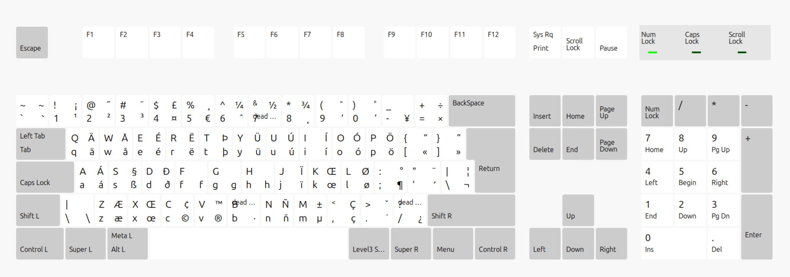

<!-- website
repository: https://github.com/Athesto/keyboard-layouts
-->

# US International — AltGr dead keys

Keep the familiar US layout and type accented letters with AltGr.
Regular quotes type immediately. On macOS, use Option instead of AltGr.
Based on Linux's `us(altgr-intl)` layout.

[Windows downloads][releases]
[macOS layout][mac-download]

## Install

### 🪟 Windows

Download and run the MSI for your system: **x64** or **x86**. Add
**US International — AltGr dead keys** under English (United States)
in Windows language settings. Sign out and back in if it does not appear.

Packages require administrator approval, are unsigned and do not support
ARM64. Pre-releases are for testing. [Windows guide](windows/README.md).

### 🍎 macOS

Run this in Terminal to download the layout:

```sh
curl --fail --create-dirs -L \
  --output "$HOME/Library/Keyboard Layouts/us-intl-altgr.keylayout" \
  https://athesto.github.io/keyboard-layouts/mac/us-intl-altgr.keylayout
```

Log out and back in, then add **US International — AltGr dead keys** in
Input Sources. When updating, switch to ABC before replacing the file.

### 🐧 Linux

Select **English (intl., with AltGr dead keys)** in keyboard settings:
layout `us`, variant `altgr-intl`. No download needed.
[Linux reference](linux/README.md).

## Spanish and Portuguese

Use these direct combinations. Add Shift for uppercase letters.

| Keys | Result |
| --- | --- |
| AltGr + A / E / I / O / U | á / é / í / ó / ú |
| AltGr + N | ñ |
| AltGr + Y | ü |
| AltGr + comma | ç |
| AltGr + / | ¿ |
| Shift + AltGr + 1 | ¡ |

For other accents, press the dead key, **release all keys**, then type
one letter. The grave key is the backtick key to the left of 1 on a US layout.

| Accent | Dead key | Then type | Result |
| --- | --- | --- | --- |
| Acute | AltGr + quote | a | á |
| Grave | AltGr + grave | a | à |
| Circumflex | AltGr + 6 | a / e / o | â / ê / ô |
| Tilde | Shift + AltGr + grave | a / o | ã / õ |

## Full layout

[](pictures/us-intl-altgr.png)

Each key shows **Shift** at top left, **Shift + AltGr** at top right,
**normal** at bottom left and **AltGr** at bottom right. Click to enlarge.

## Compatibility

The main character mappings follow the Linux reference. Some dead-key
compositions and system shortcuts differ across platforms; see the
[compatibility report](linux/COMPARISON.md).

<!-- github-only:start -->
## Website maintenance

Edit this README for content and `site/template.html` for presentation.
See the [Pandoc build instructions](site/README.md) for local previews.

## TODO
- include command into button below "tab" and left of "1" for iso keyboard
<!-- github-only:end -->

---

Mac template: [xv0x7c0][mac-original] · Related work:
[Tobias Müller][mac-reference] and [Windows AltGr layout][win-reference] ·
[Source code](https://github.com/Athesto/keyboard-layouts).

[releases]: https://github.com/Athesto/keyboard-layouts/releases
[mac-download]: https://athesto.github.io/keyboard-layouts/mac/us-intl-altgr.keylayout
[mac-original]: https://github.com/xv0x7c0/osx-us-altgr-intl
[mac-reference]: https://www.twam.info/hardware/us-international-on-os-x
[win-reference]: https://github.com/thomasfaingnaert/win-us-intl-altgr
